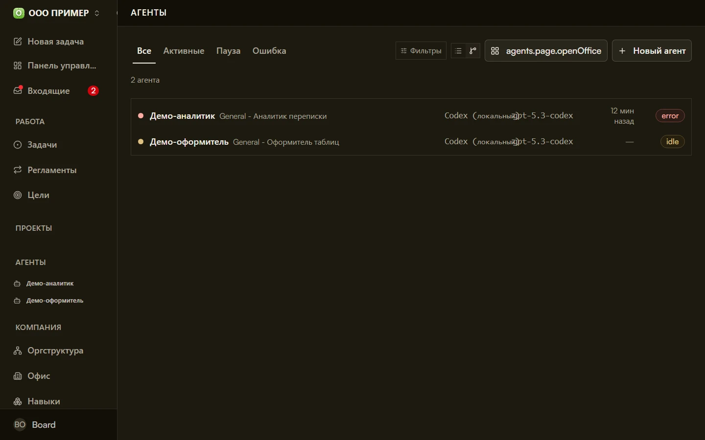

# Агенты в Datagent — роли, задачи и контроль

Агент — это роль в компании: модель, инструкция и разрешённые инструменты. Поручение оформляется как **задача**, а не как бесконечный чат — шаги видны в журнале.

Сначала имеет смысл прочитать [что такое Datagent](./what-is-datagent) и [как это работает](./how-it-works), затем создать агента в [Cloud](/docs/cloud/first-agent).

## Агент — роль с доступом к данным

«Собери просроченные сделки», «подготовь сводку по остаткам», «разбери входящие» — агент берёт формулировку и работает в рамках доступов. Результат лежит в задаче на [app.datagent.ru](https://app.datagent.ru).

**Как это устроено:**

1. Создайте агента — имя, модель (GigaChat, YandexGPT и др.), инструкция.
2. Поставьте **задачу** с формулировкой работы.
3. Нажмите **Запустить** — агент читает контекст и вызывает разрешённые инструменты.
4. Перед риском — [согласование](./approvals).
5. Итог и шаги — в журнале задачи.

Каждый запуск учитывается в **лимите тарифа**. На бесплатном тарифе до **3 агентов** и **100 запусков** в месяц. Подробнее: [Запуски и лимиты](./credits).

:::tip[Доступно бесплатно]
GigaChat и YandexGPT на бесплатном тарифе не требуют оплаты подписки Datagent. Нужны ключи провайдера по инструкции в панели.
[Зарегистрироваться →](https://app.datagent.ru/signup)
:::

## Что агент умеет делать

- **Готовить сводки** по разрешённым данным подключённых сервисов (склад, маркетплейсы, CRM и др.)
- **Отвечать в сценариях каналов** — например, чат Битрикс24 через задачу и согласование
- **Работать с задачей целиком** — переписка, файлы и запуски в одном месте
- **Открывать сайты** через [BrowserBridge](../integrations/browserbridge). Не входит в бесплатный тариф, доступно на платных условиях, [уточните у нас](https://datagent.ru/#demo).
- **Помнить контекст компании** — [память](./memory)
- **Не зависать на полпути** — платформа перезапустит сеанс при сбое ([пульс](./heartbeat))
- **Связать 1С и документы** через плагины ([1С](../integrations/1c-connector) на тарифе Корпоративный, сценарии Office отдельно)

Агент **не** заменяет юриста или финансиста. Готовые Russia-коннекторы — **только чтение**.

:::info[Битрикс24, браузер и коннекторы]
Ответы в сценариях **Битрикс24**, **BrowserBridge** и готовые коннекторы к российским сервисам не входят в бесплатный тариф. Доступно на платных условиях, [уточните у нас](https://datagent.ru/#demo).
:::

## Чего агент не делает (честно)

- **Не принимает решения за вас** — рискованные шаги ждут согласования.
- **Не работает без сети** — Cloud и модели требуют доступа к сервисам.
- **Не чинит мусор в данных** — качество ответа зависит от качества исходных данных.

## Сколько запусков входит в тариф

| Тариф | Агентов | Запусков в месяц | Условия |
| --- | --- | --- | --- |
| **Бесплатный** | до 3 | 100 | Бесплатно |
| **Корпоративный** | по договору | по договору | Условия под вашу компанию |

Один **запуск агента** — один цикл работы от задачи до результата. Подробнее: [Запуски и лимиты](./credits).

## Что дальше?

- [Первый агент](../cloud/first-agent)
- [Интеграции](../integrations/overview)
- [Практические руководства](../tutorials)
