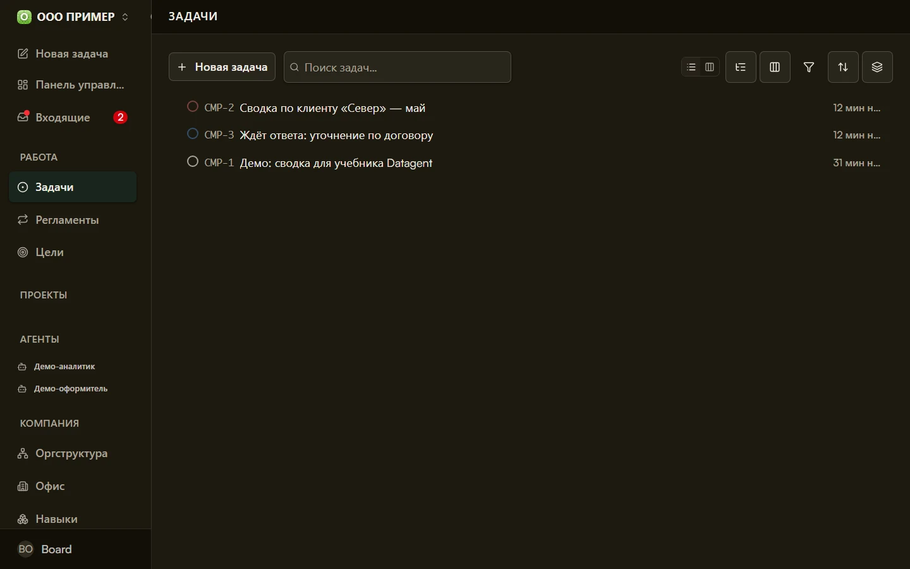

# Задачи агентам в Datagent

Задача — это поручение с результатом: что сделать, кому поручить и где забрать готовый файл или ответ.

## Пример

Директор пишет: «Собери список сделок без активности больше недели». Агент забирает данные из CRM, кладёт таблицу в задачу. Директор смотрит результат и решает, кому из менеджеров напомнить о клиенте.

## Как устроено

1. **Создайте задачу** — заголовок и описание на [app.datagent.ru](https://app.datagent.ru).
2. **Назначьте агента** — у задачи один исполнитель.
3. **Нажмите «Запустить»** — агент приступает к работе.
4. **Проверьте журнал** — при риске откроется [одобрение](./approvals).
5. **Заберите результат** — текст в задаче и вложенные файлы.

Связанные задачи можно собрать в [проект](./projects). Разовые поручения — без проекта.

## Статусы задачи

| Статус | Что происходит |
| --- | --- |
| **Новая** | Создана, агент ещё не взялся |
| **В работе** | Агент выполняет |
| **Ожидает одобрения** | Агент ждёт вашего решения |
| **Завершена** | Результат готов |
| **Остановлена** | Задача прервана |

В панели подписи могут отличаться («в очереди», «на проверке») — смысл тот же.

:::info[Большие задачи по шагам]
Разбиение крупного поручения на подзадачи не входит в бесплатный тариф, доступно на платных условиях, [уточните у нас](https://datagent.ru/#demo). Вы один раз принимаете **план**, дальше шаги идут по порядку.
:::

Пошаговый сценарий в учебнике — [одна задача от начала до результата](/docs/guides/03-one-task).

## Что дальше

→ [Одобрения](./approvals)
